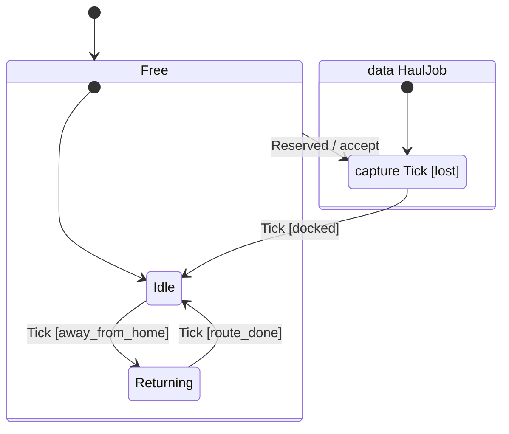

# Diagrams

`gochart diagram` draws a gochart as a [Mermaid](https://mermaid.js.org/syntax/stateDiagram.html)
state diagram (`stateDiagram-v2`). It works from the IR, so it draws gocharts of any language, and
the diagram always matches the chart. Mermaid renders in GitHub markdown: put the output in a
` ```mermaid ` block.

```
gochart diagram hauler.gochart             # Prints the diagram.
gochart diagram hauler.gochart hauler.mmd  # Writes it to a file.
```

## What It Shows

- **States.** A state with children is a box holding them, with an arrow from `[*]` to its default
  child. The children of a parallel state are separated by dashed lines, one per region. A
  parallel gochart is drawn as one box named after the gochart.
- **Transitions** are arrows labeled `Trigger [condition] / action`. Null transitions have no
  trigger. Transitions of the gochart level start from an "any state" box.
- **Inside a state's box:** its data (`data HaulJob`), its enter and exit reactions (`enter`,
  `exit on Tick`) and its captures (`capture Tick [busy]`).
- **Conditions and actions** show the callback name of Rust gocharts (`[docked]`, `/ accept`).
  Inlined code (C++) shows as `[…]` and `/ …`.

For example, this Rust gochart:

```
gochart Hauler(language = "rust") {
	trigger Tick()
	trigger Reserved(job: HaulJob)

	state Free {
		transition Reserved > ToPickup do accept

		state Idle {
			transition Tick > Returning if away_from_home
		}

		state Returning {
			transition Tick > Idle if route_done
		}
	}

	state Hauling(data = "HaulJob") {
		state ToPickup {
			capture Tick if lost
			transition Tick > Idle if docked
		}
	}
}
```

is drawn as:



## Bazel

`defs.bzl` has a rule that writes the diagram to `<name>.mmd` (or `out`):

```python
load("@gochart//:defs.bzl", "generate_gochart_diagram")

generate_gochart_diagram(
    name = "hauler_diagram",
    src = "hauler.gochart",
)
```
