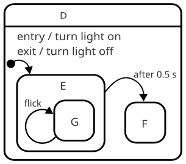

# Gochart Documentation

## About Statecharts

Statecharts seem to have a long history of usage in the game industry, especially in Ubisoft.
On their part Unreal did a [graphical version of something very akin to statecharts](https://docs.unrealengine.com/5.0/en-US/overview-of-state-tree-in-unreal-engine/),
albeit not focused to code and more limited in scope (mostly geared to replace/expand their Behavior
Trees.

You can see the [original paper](https://www.sciencedirect.com/science/article/pii/0167642387900359).
It is relatively simple to read.

## Gochart Definition

    

TODO: Write
